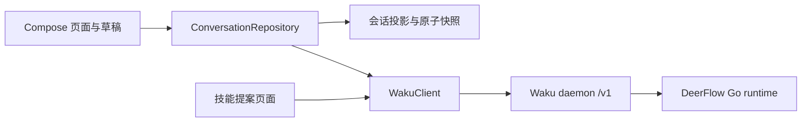

# DeerFlow Android 接入方案与实现

## 决策

Android 直接实现当前 `deerflow-api` 分支的 Waku v10 客户端，使用 `/v1` WebSocket；由 Waku daemon 管理 DeerFlow Go runtime，手机承担会话展示、用户命令、审批和本地恢复。此次直接替换 AG-UI 网络入口，不做灰度或双协议路由。旧记录只读保留。

协议基线来自本地 `deerflow-api` 的 `desktop-app/crates/waku-protocol/src/protocol.rs`、`desktop-app/crates/waku-core/src/daemon.rs`、`desktop-app/packages/waku-client/src/generated/AgentSession.ts` 以及 `desktop-app/apps/mobile/src/lib/daemon-api.ts`。这是 tagged JSON 命令/响应/事件协议，不是直接兼容 Codex JSON-RPC 的接口；不能只替换原 SSE URL。

## 业界做法与本项目取舍

Codex App Server 把会话恢复、启动新一轮、取消及工具审批拆成独立操作，运行进度由事件驱动；取消 ACK 和最终结束事件也分开。本项目采用同样的职责分离，用 Waku 原生命令映射这些行为。[Codex App Server 官方文档](https://learn.chatgpt.com/docs/app-server)

Claude Code Remote Control 让执行进程留在原机器上，手机接入该会话；网络连接可以恢复，执行环境不随手机迁移。本项目同样让服务端执行，手机进入后台仅停止订阅，回到前台重新核对历史及补齐事件。[Claude Code Remote Control 官方文档](https://code.claude.com/docs/en/remote-control)

Claude Agent SDK 的 session ID 用于恢复持久对话；对话恢复与文件系统检查点属于不同机制。本项目明确区分服务端会话 ID、runtime ID、事件 epoch、用户命令 ID，避免把重新建连接误当成新任务或恢复执行。[Claude Agent SDK 会话文档](https://code.claude.com/docs/en/agent-sdk/sessions)

以下恢复规则是依据当前 Waku 实现作出的工程决策，不表示上述产品使用相同实现或提供相同保证。

## 分层

`WakuClient` 只管理认证、请求关联、有限事件缓冲和连接状态，不重试写操作。`WakuProjection` 从事件生成与桌面兼容的会话快照。`ConversationRepository` 管理前后台、网络切换、恢复和命令生命周期。草稿、会话快照、附件缓存分别保存，并按连接配置隔离。

## 断线恢复顺序

1. `hello` 验证 Token 与协议版本。认证/版本错误停止自动重连；普通网络错误使用指数退避和抖动。
2. `loadTaskState` 读取目录，再 `hydrateSession` 读取完整会话。列表中的空历史字段不得覆盖完整缓存。
3. `attachSession` 附加现有 runtime，连接恢复不调用 `start` 替换执行进程。
4. 固定 `throughSequence`，分页 `replayEvents`，同期实时事件进入有限缓冲。按 session/runtime/epoch/sequence 验证并去重后再接入实时事件。
5. 内容和游标写入同一原子文件，随后检查点同步到服务器。游标不能先于对应内容持久化。

当前 v10 的审批请求不在会话快照中，所以恢复时需要扫描存活 runtime 的日志重建交互卡；正文仍按已保存游标去重。若 runtime 已不存在，清理过期交互卡。原生历史导入有条数和字段限制，只能补充缺失记录，不能覆盖已经保存的完整正文和工具块。

## 写操作与附件

发送前先原子保存原文、附件引用及命令 ID，再上传附件、发送 prompt。只有本地保存成功才清空输入框。断线后不自动重发 prompt、审批或取消；通过精确 message ID 核对 prompt，不能按相同文字猜测已经发送。

请求失败区分确定未发送、服务端拒绝、结果未知。结果未知保留原文和提示，后续动作由用户显式发起。附件上传失败不降级成只发文字。产物按服务器授权读取，校验大小、偏移及摘要后保存到客户端私有缓存；外部 URL 不携带 daemon Token。

## 边界与后续服务端能力

当前 Waku 的去重缓存和事件日志没有跨 daemon 重启的事务保证。因此此次客户端不承诺跨重启 exactly-once，不将未知操作自动标成成功。跨端审批也缺少完整的 pending snapshot / resolved 通知，恢复只能使用现有协议证据。

若后续需要更强的移动端恢复语义，服务端应增加持久 command ledger、可查询的执行结果、待交互快照及完成广播，并定义带保留期限的事件恢复接口。这些属于服务端协议演进，本次 app 分支没有修改后端工作区。

验证方法见 [弱网验收清单](waku-mobile-validation.md)。
