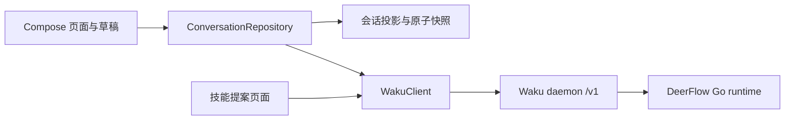

# DeerFlow Android 接入方案与实现

## 决策

Android 直接实现当前 `deerflow-api` 分支的 Waku v12 客户端，使用 `/v1` WebSocket；由 Waku daemon 管理 DeerFlow Go runtime，手机承担会话展示、用户命令、审批和本地恢复。旧 AG-UI 记录只读保留。

协议基线来自本地 `deerflow-api` 的 `desktop-app/crates/waku-protocol/src/protocol.rs`、`desktop-app/crates/waku-core/src/daemon.rs`、`desktop-app/packages/waku-client/src/generated/AgentSession.ts` 以及 `desktop-app/apps/mobile/src/lib/daemon-api.ts`。这是 tagged JSON 命令/响应/事件协议，不是直接兼容 Codex JSON-RPC 的接口；不能只替换原 SSE URL。

## 业界做法与本项目取舍

Codex App Server 把会话恢复、启动新一轮、取消及工具审批拆成独立操作，运行进度由事件驱动；取消 ACK 和最终结束事件也分开。本项目采用同样的职责分离，用 Waku 原生命令映射这些行为。[Codex App Server 官方文档](https://learn.chatgpt.com/docs/app-server)

Claude Code Remote Control 让执行进程留在原机器上，手机接入该会话；网络连接可以恢复，执行环境不随手机迁移。本项目同样让服务端执行，手机进入后台仅停止订阅，回到前台重新核对历史及补齐事件。[Claude Code Remote Control 官方文档](https://code.claude.com/docs/en/remote-control)

Claude Agent SDK 的 session ID 用于恢复持久对话；对话恢复与文件系统检查点属于不同机制。本项目明确区分服务端会话 ID、runtime ID、事件 epoch、用户命令 ID，避免把重新建连接误当成新任务或恢复执行。[Claude Agent SDK 会话文档](https://code.claude.com/docs/en/agent-sdk/sessions)

以下恢复规则是依据当前 Waku 实现作出的工程决策，不表示上述产品使用相同实现或提供相同保证。

## 分层

`WakuClient` 只管理认证、请求关联、有限事件缓冲和连接状态，不重试写操作。`WakuProjection` 从事件生成与桌面兼容的会话快照。`ConversationRepository` 管理前后台、网络切换、恢复和命令生命周期。草稿、会话快照、附件缓存分别保存，并按连接配置隔离。

## 断线恢复顺序

1. `hello` 验证 Token 与协议版本。认证/版本错误停止自动重连；普通网络错误使用指数退避和抖动。
2. 握手成功即标记网络已连接；`loadTaskState` 读取目录，目录中的空历史字段不覆盖完整缓存。会话恢复状态与网络状态分开显示。
3. `attachSession` 附加现有 runtime，优先使用与其匹配的本地原子快照。仅无有效缓存、主动刷新、runtime/epoch 变化或 runtime 已结束时通过 `hydrateSession` 核对完整历史，不调用 `start` 替换执行进程。
4. 从已保存游标开始，固定 `throughSequence`，以每页最多 64 个事件增量读取；每页响应有 30 秒超时。同期实时事件进入有限缓冲，按 session/runtime/epoch/sequence 验证并去重后接入。
5. 每页的内容与游标写入同一原子文件后才请求下一页，中断后不从零重放。会话单独解锁；同一会话的并发恢复共用结果，失败不会被误判为已完成。同步进度与错误在会话状态栏显示。

当前 v12 的审批请求仍不在服务端会话快照中。只有处于 waiting 且本地交互状态未经验证时才单独补读控制历史，控制游标逐页落盘；补读完成前不显示未经核对的交互卡。`attachSession.deerflowReady` 优先恢复当前产物连接，历史 Ready 不能覆盖该快照，新实时 Ready 可以更新连接。`invalidated` 只表示任务数据需要刷新，保留绑定、能力和在途查询；每次产物读取都会重新查询任务树和产物页。只有 runtime 退出、更换或 epoch 变化才清除过期连接信息，已下载的文件缓存保留。缺少连接信息时才在后台补读产物控制历史，也保存进度。若 runtime 已不存在，清理过期交互卡。原生历史导入只用于正文与工具块都缺失的快照。

2.2.0 曾把 `invalidated` 错当成能力撤销，可能保存了有效游标但缺少 Ready 的控制检查点。2.2.1 先完成已保存位置后的增量查询；仍缺少 Ready 时，最多再从头执行一次只读恢复，重建原始能力声明。每页仍原子保存，不重发 prompt、审批或执行命令。运行时退出会撤销读取能力并停止自动产物查询；没有产物的正常查询返回空列表。

## v12 历史修订与会话元数据

新会话带有 `history_revision = 0`；旧版 Android 快照没有此字段时按 0 读取。修订号由 daemon 管理，只能与对应的完整正文一起更新。目录通知发现更高修订后，立即暂停该会话的发送、旧投影上报和文件读取；选中或已订阅的会话重新 hydrate／attach，其他会话在打开时恢复。目录的空正文和游标不覆盖完整缓存，标题补读也不能单独推进历史修订。

比较快照时，历史修订优先于事件 sequence。更高服务端修订清除旧审批、控制检查点和产物连接，保留待核对用户命令；迟到的低修订快照不能恢复旧轮次。完整历史读取后再次 attach，避免桌面回退恰好发生在读取期间而将旧 runtime 日志接到新正文上。

`attachSession.pendingHistory` 保存于本地原子快照，表示 daemon 尚未完成的回退或分叉操作；存在时不发送 prompt、审批和后台投影，显示在桌面恢复后重新同步的提示。它不提供待审批快照。`conversationCapability` 以本次 attach／实时事件为准，runtime 更换或退出时清除。手机接收 `steeringUpdated` 并以 request ID 更新同一条用户消息，保留干预状态与原文；本次协议迁移未添加手机主动干预、分叉、回退或预算编辑入口。

连接输入由实际配置、后台保留策略、原子的网络状态及显式刷新序号组成。相同配置去重，因此记忆回执落盘不会取消聊天订阅；网络切换仍会更换连接。迟到页在取消或链接身份检查失败后不能提交。

## 会话标题

`WakuSessionTitles` 统一列表、顶部标题及历史恢复的规则：用户显式 `title` 优先于 `auto_title`；两者缺失时从首条用户可见消息取默认摘要，保持 Waku 桌面端的 7 词／54 Unicode 码点限制。新 `promptSubmitted` 事件生成并保存默认标题，不依赖 provider 必须发送 `autoTitleUpdated`；历史加载也会补齐旧版缺失的标题。可见内容为空的附件消息使用附件名称，不把隐藏的 provider 包装文本当标题。

`loadTaskState` 是精简目录，`messages` 和 `runtime_event_cursor` 都不完整。目录刷新串行化并只合并手动标题。自动标题不一致或旧会话无标题时，单个可取消的后台读取流程用 `hydrateSession` 读取完整详情；按目录版本去重，不附加 runtime、不执行 prompt。已缓存会话只更新标题字段，自动标题按同一 runtime/epoch 的游标比较，防止较旧快照覆盖新事件；聊天正文、游标、待处理操作不被标题同步替换。

## 前后台连接与通知

连接条件由界面可见性、60 秒空闲宽限期和前台服务持有状态共同决定。只在最终“需要连接”值变化时替换连接任务；界面进入后台但服务仍运行时，不会取消旧 socket。恢复前台使用有期限的只读请求检查连接，不自动重复提交任务。

提交消息前先记录传输计数，并在 Activity 仍可见时申请前台服务；原有服务端任务在前台同步后也可启动保护。任务、待处理交互或未确认操作尚存在时继续接收；任务结束后释放服务。通知的“暂停后台接收”和系统超时只释放订阅，不发送 cancel/stop 任务命令。服务采用 START_NOT_STICKY，不在进程重启或开机时重放用户命令。

前台服务类型为 dataSync，用于同步服务器会话和执行进度，并声明相应权限和常驻通知。Android 15 及以上的后台时限通过 onTimeout 及时停止服务处理。通知权限被拒绝不阻止前台聊天，用户可在设置中开启通知；通知正文只含任务状态，不包含对话、参数、输出或凭据。

任务结束／待处理通知仅由当前连接收到的新事件触发，历史回放不重复通知。没有引入 FCM 或厂商推送，因此进程完全终止时不承诺通知送达；重连仍使用原有历史与事件恢复协议。

Android 契约参考：[服务类型](https://developer.android.com/develop/background-work/services/fgs/service-types)、[后台启动限制](https://developer.android.com/develop/background-work/services/fgs/restrictions-bg-start)、[服务运行时限](https://developer.android.com/develop/background-work/services/fgs/timeout)、[通知权限](https://developer.android.com/develop/ui/compose/notifications/notification-permission)。

## Full Access 的服务端确认

新 runtime 使用 `start.options.mode = fullAccess`。已有原生会话恢复会保留旧审批策略，`applyOptions` 的 mode 不改变 DeerFlow 权限。下一条消息发送前，若当前链接尚未收到权限广播，或状态不是 `allow_always` / `off`，按用户既有 Full Access 设置向已附加的 session/runtime 发出 `setToolApproval(allow_always)`；只有匹配的服务端确认才允许发送 prompt。无需为寻找旧权限广播重放整段正文；权限回执丢失仍不自动重发设置或消息。

权限跟踪器仅保存本连接上的事件证据，按 session/runtime/epoch/sequence 隔离；本地 `runtime_mode` 不是授权依据。断线和超时不会自动重复切换权限或发送 prompt。活动轮次及挂起审批仍由服务端约束，不把 Full Access 实现为客户端自动点击全部审批卡。

## 写操作与附件

发送前先原子保存原文、附件引用及命令 ID，再上传附件、发送 prompt。只有本地保存成功才清空输入框。断线后不自动重发 prompt、审批或取消；通过精确 message ID 核对 prompt，不能按相同文字猜测已经发送。

请求失败区分确定未发送、服务端拒绝、结果未知。结果未知保留原文和提示，后续动作由用户显式发起。附件上传失败不降级成只发文字。产物按服务器授权读取，校验大小、偏移及摘要后保存到客户端私有缓存；外部 URL 不携带 daemon Token。

2.3.0 的产物索引保存在会话本地快照 `artifactFiles` 中，`listArtifacts` 只查任务树和元数据，不读取文件分块。聊天投影不再追加文件卡或产物读取错误；独立页面通过 `loadArtifact` 下载所选文件，离线时可使用已校验缓存。

新提交附件先复制到按服务器凭据隔离的私有缓存，并在发送 prompt 前将原文和附件信息写入 `sentMessages[messageId]`。事件回显、完整历史同步和 runtime 更换均保留该表，只按精确 ID 绑定；历史回退移除的消息不会因附件缓存而重新显示。普通文件沿用 `storeBlob/importAttachment` 与原生 `MessageAttachment`，无需服务端协议变更。

OSS 路径由 App 直传文件，向 Agent 提交带大小、SHA-256、预签名 GET 和指定客户端标识的版本化清单。只读链接默认有效 24 小时；长期密钥只留在设备加密设置中。Agent 通过已有 `skill_run` 下载到会话输入目录并读取，生成产物仍由服务端保管。App 不把 OSS 对象冒充原生服务器附件；可见用户消息使用发送前保存的原文。

## 工具调用展示

采用“名称 + 状态”的紧凑列表：结构化工具名优先，完成事件更新同一调用行；运行指示根据该调用的 complete/failed 状态，不根据“最后一条消息”推测。参数和返回内容不进入工具行，也不提供详情展开。旧记录缺少可靠名称时使用工具类型，不以路径、命令文本或返回内容冒充名称。

参考 [VS Code 工具调用默认折叠详情](https://code.visualstudio.com/docs/agents/run/tools)与 [Material 列表的名称、前置图标和尾部状态结构](https://m3.material.io/components/lists/overview)，并按本项目要求完全隐藏工具详情。会话原始数据仍保留，保证恢复与其他客户端兼容。

## 边界与后续服务端能力

当前 Waku 的去重缓存和事件日志没有跨 daemon 重启的事务保证。因此此次客户端不承诺跨重启 exactly-once，不将未知操作自动标成成功。跨端审批也缺少完整的 pending snapshot / resolved 通知，恢复只能使用现有协议证据。

若后续需要更强的移动端恢复语义，服务端应增加持久 command ledger、可查询的执行结果、待交互快照及完成广播，并定义带保留期限的事件恢复接口。这些属于服务端协议演进，本次 app 分支没有修改后端工作区。

验证方法见 [弱网验收清单](waku-mobile-validation.md)。
